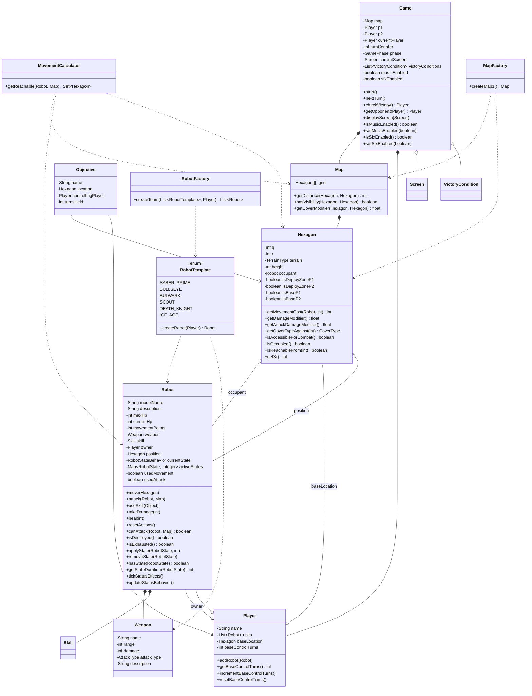
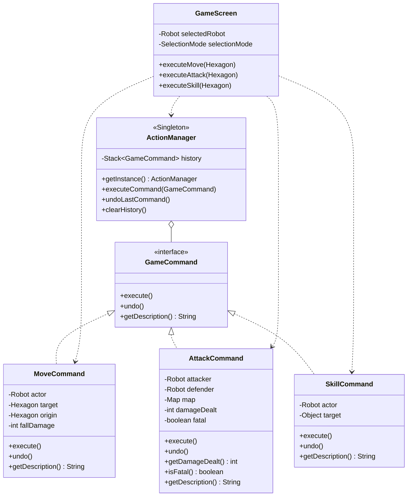
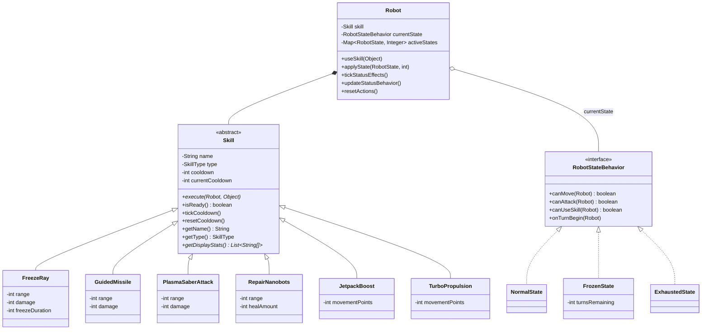
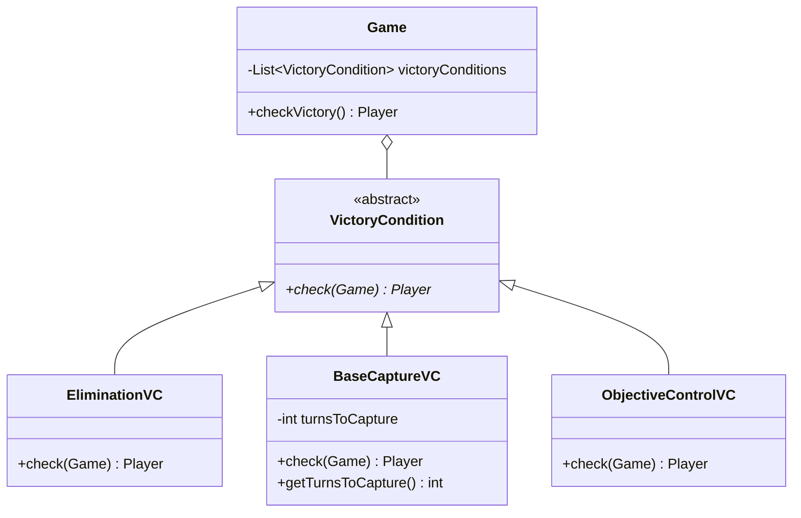
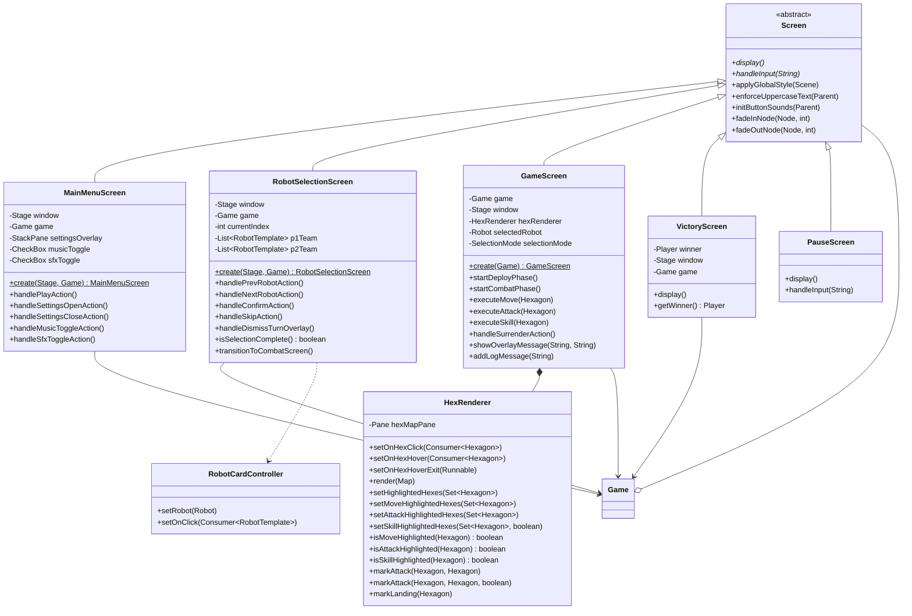
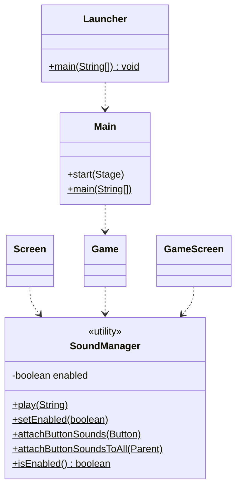

# UML de Clases — DAW1

Diagramas de clases generados por **ingeniería inversa** del código fuente (marzo 2026).
Incluye también una sección final de **arquitectura objetivo planificada** para la futura integración de IA, simulación masiva y telemetría.
Divididos en secciones para mantener legibilidad. Las relaciones de los enums de apoyo se describen en la sección 8.

---

## 1. Núcleo del dominio (`engine` + `model`)

---

## 2. Comandos y flujo de acciones (Command Pattern)

---

## 3. Skills y estados del robot (State Pattern)

---

## 4. Condiciones de victoria (Strategy Pattern)

> **Nota**: `ObjectiveControlVC` está implementado en el código pero **no se instancia aún** en el `Game` del MVP. Es una extensión preparada para futuras versiones.

---

## 5. UI y navegación de pantallas

> **Nota**: `PauseScreen` existe como stub en el código pero la lógica de pausa/rendición está integrada directamente en `GameScreen` mediante overlays FXML.

---

## 6. Bootstrap y utilidades

---

## 7. IA, ejecución de partidas y telemetría (arquitectura objetivo)

> **Nota**: Este bloque describe la **extensión prevista** para `PvIA`, `IAvsIA` y simulación de balanceo. No corresponde todavía al código implementado en marzo de 2026.

```mermaid
classDiagram
    class PlayerController {
      <<interface>>
      +decideNextStep(MatchContext, Player) TurnDecision
    }

    class HumanController {
      +decideNextStep(MatchContext, Player) TurnDecision
    }

    class AiController {
      -AiStrategy strategy
      +decideNextStep(MatchContext, Player) TurnDecision
    }

    class AiStrategy {
      <<interface>>
      +chooseDecision(MatchContext, Player) TurnDecision
    }

    class EasyAiStrategy {
      -ActionEvaluator evaluator
      +chooseDecision(MatchContext, Player) TurnDecision
    }

    class ActionEvaluator {
      +scoreMove(MatchContext, Robot, Hexagon) int
      +scoreAttack(MatchContext, Robot, Robot) int
      +scoreSkill(MatchContext, Robot, Object) int
    }

    class TurnDecision {
      <<abstract>>
    }

    class ExecuteCommandDecision {
      -GameCommand command
      +getCommand() GameCommand
    }

    class EndTurnDecision

    class TurnEngine {
      +getLegalCommands(Game, Player, Robot) List~GameCommand~
      +execute(GameCommand)
      +endTurn(Game)
      +checkVictory(Game) Player
    }

    class MatchContext {
      -Game game
      -long seed
      -int maxTurns
      -boolean headless
      +getGame() Game
    }

    class MatchRunner {
      -TurnEngine turnEngine
      -List~GameEventListener~ listeners
      +runMatch(MatchContext, PlayerController, PlayerController) MatchResult
    }

    class MatchResult {
      -Player winner
      -String victoryType
      -int turnCount
      -long seed
    }

    class BatchSimulationService {
      -MatchRunner matchRunner
      +runBatch(BatchSimulationConfig) SimulationStats
    }

    class BatchSimulationConfig {
      -int matchCount
      -long seed
      -int maxTurns
    }

    class SimulationStats {
      +record(MatchResult)
      +exportCsv(Path)
      +exportJson(Path)
    }

    class GameEvent {
      <<abstract>>
      +getType() String
    }

    class TurnEndedEvent
    class AttackResolvedEvent
    class RobotDestroyedEvent
    class MatchFinishedEvent

    class GameEventListener {
      <<interface>>
      +onEvent(GameEvent)
    }

    class StatsCollector {
      +onEvent(GameEvent)
      +toSimulationStats() SimulationStats
    }

    PlayerController <|.. HumanController
    PlayerController <|.. AiController
    AiStrategy <|.. EasyAiStrategy
    TurnDecision <|-- ExecuteCommandDecision
    TurnDecision <|-- EndTurnDecision
    AiController o-- AiStrategy
    EasyAiStrategy o-- ActionEvaluator
    ExecuteCommandDecision o-- GameCommand
    MatchContext o-- Game
    MatchRunner o-- TurnEngine
    MatchRunner o-- MatchContext
    MatchRunner o-- MatchResult
    MatchRunner o-- GameEventListener
    BatchSimulationService o-- MatchRunner
    BatchSimulationService o-- BatchSimulationConfig
    BatchSimulationService o-- SimulationStats
    GameEvent <|-- TurnEndedEvent
    GameEvent <|-- AttackResolvedEvent
    GameEvent <|-- RobotDestroyedEvent
    GameEvent <|-- MatchFinishedEvent
    GameEventListener <|.. StatsCollector
    StatsCollector ..> SimulationStats
    TurnEngine ..> GameCommand
    TurnEngine ..> Game
    TurnEngine ..> Player
    TurnEngine ..> Robot
```

---

## 8. Enums de apoyo

| Enum            | Valores                                                                  | Uso principal                                  |
| --------------- | ------------------------------------------------------------------------ | ---------------------------------------------- |
| `GamePhase`     | `DEPLOYING`, `COMBAT`                                                    | Estado de fase en `Game`                       |
| `RobotTemplate` | `SABER_PRIME`, `BULLSEYE`, `BULWARK`, `SCOUT`, `DEATH_KNIGHT`, `ICE_AGE` | Fábrica de robots en selección                 |
| `TerrainType`   | `NORMAL`, `VEGETATION`, `WATER_SHALLOW`, `WATER_DEEP`                    | Tipo de casilla en `Hexagon`                   |
| `CoverType`     | `NONE`, `HALF`, `FULL`                                                   | Cobertura de casillas en resolución de ataque  |
| `AttackType`    | `ENERGY`, `EXPLOSIVE`, `KINETIC`                                         | Tipo de arma en `Weapon` → SFX                 |
| `SkillType`     | `MOVEMENT`, `ATTACK`                                                     | Tipo de skill → modo de resaltado en mapa      |
| `RobotState`    | `FROZEN`, `EXHAUSTED`                                                    | Estado activo del robot → `RobotStateBehavior` |

---

## Notas

- Se priorizan clases de dominio y relaciones relevantes de ejecución.
- Los métodos FXML (`@FXML`) están omitidos en los diagramas de UI para no saturarlos; solo se muestran los handlers de acciones relevantes.
- La sección 7 representa una **arquitectura objetivo** y no una fotografía exacta del código actual.
- Las convenciones de relación usadas:
  - `*--` composición (el hijo no vive sin el padre)
  - `o--` agregación (el hijo puede cambiar o existir independientemente)
  - `-->` dependencia de referencia directa
  - `..>` dependencia de uso puntual
