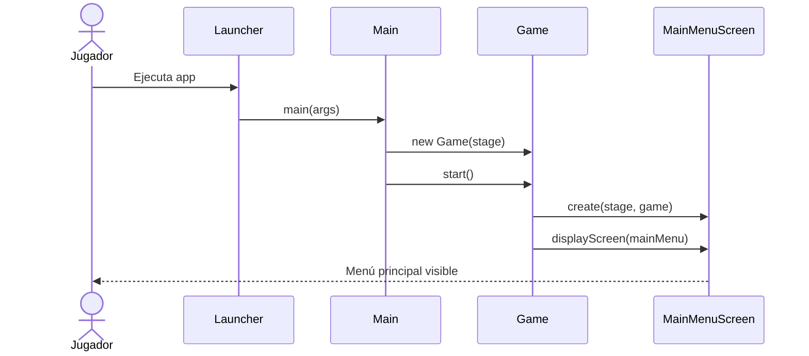
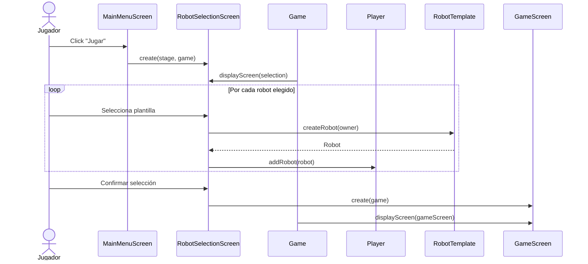
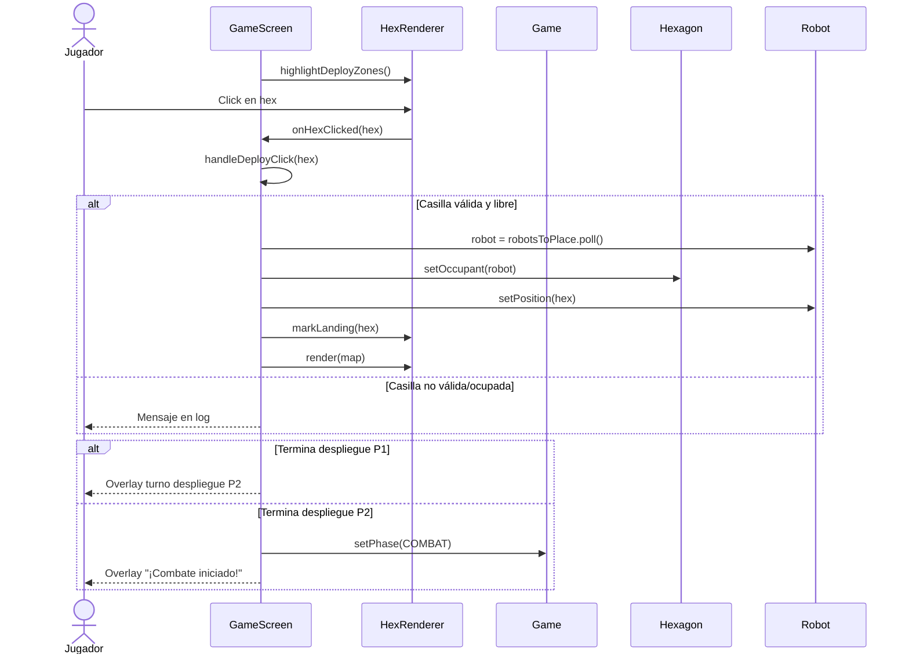
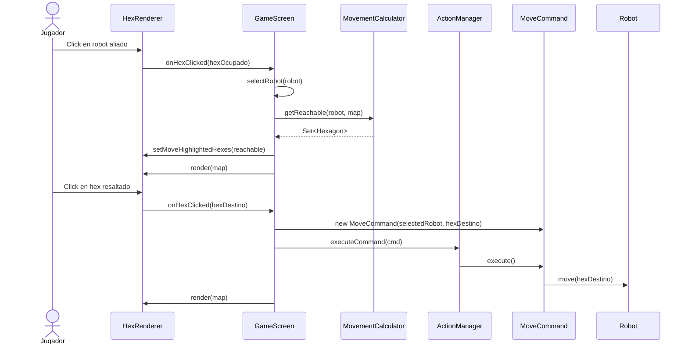
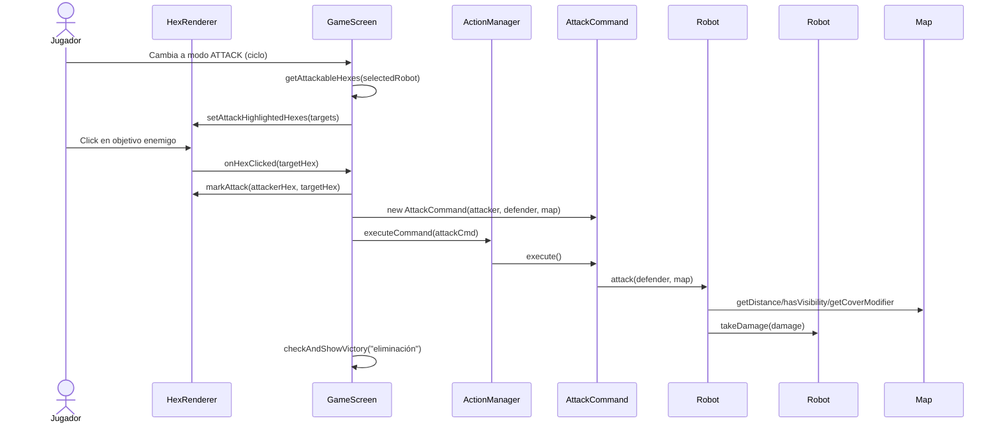
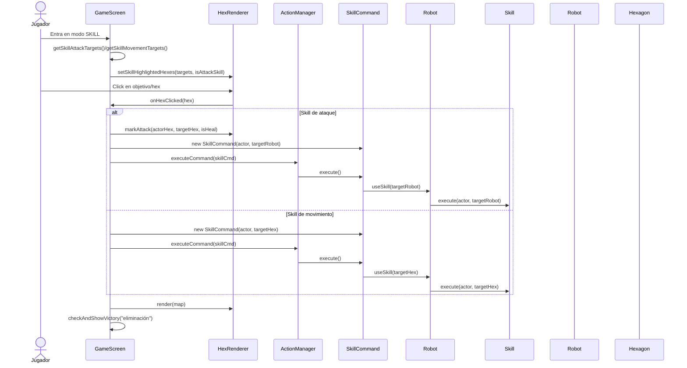
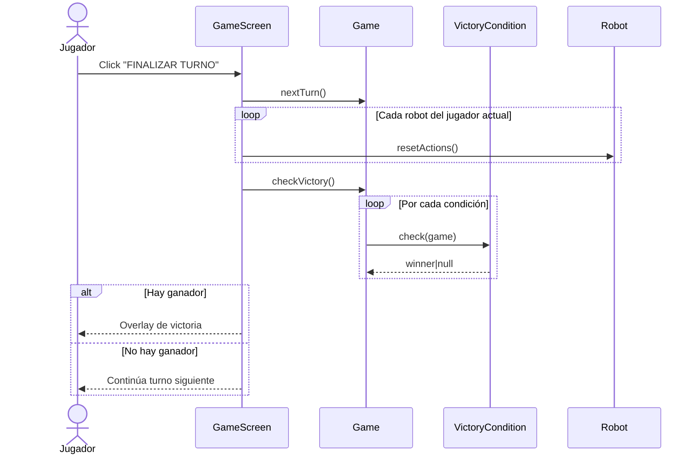
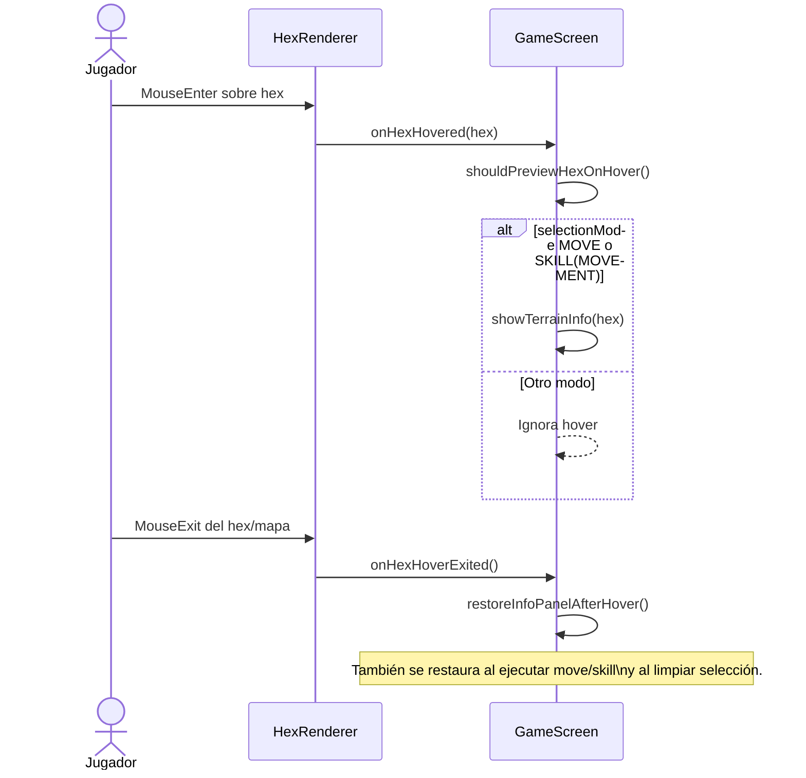

# UML de Secuencia (Flujos Clave)

Este documento recoge los flujos más importantes del juego en diagramas de secuencia Mermaid.

## 1) Arranque y navegación inicial

## 2) Selección de robots y paso a combate

## 3) Despliegue en mapa (fase DEPLOYING)

## 4) Selección de robot y movimiento

## 5) Ataque normal

## 6) Uso de skill (ataque o movimiento)

## 7) Fin de turno y condiciones de victoria

## 8) Hover de info de hex en movimiento/skill de movimiento

