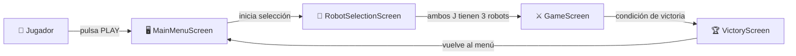
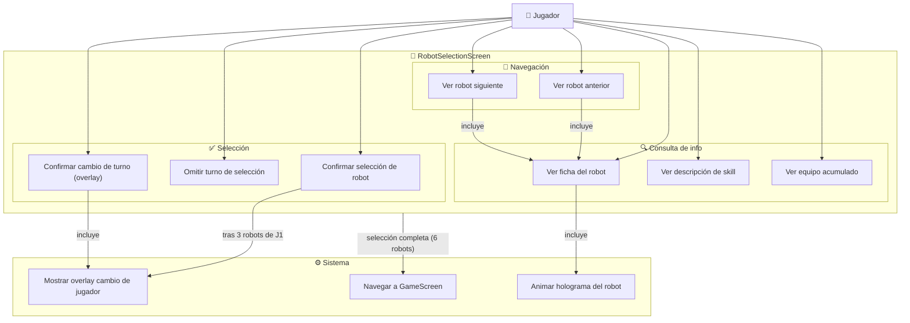
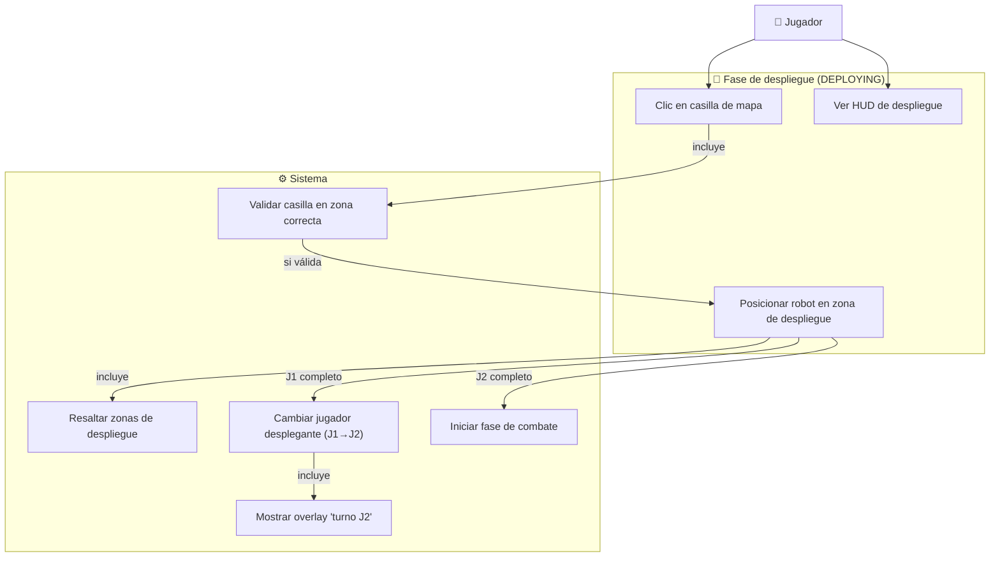

# Diagramas de Casos de Uso — DAW1

Diagramas de casos de uso del juego **Devastation Ai Wars 1 (DAW1)**, generados mediante **ingeniería inversa** del código fuente real del proyecto.

> **Actores**:
> - **Jugador** — única entidad humana del sistema (J1 y J2 tienen el mismo rol, se unifican).
> - **Sistema** — actor secundario que ejecuta lógica automática sin intervención del usuario.

---

## 1. Flujo global de pantallas

Visión general de la navegación entre pantallas del juego.



---

## 2. Pantalla de Inicio (`MainMenuScreen`)

Pantalla de bienvenida. Permite iniciar partida y configurar ajustes de audio.

```mermaid
graph TD
    J[\"👤 Jugador\"]

    subgraph MM[\"🖥️ MainMenuScreen\"]
        UC_PLAY[\"Iniciar partida\"]
        UC_SETTINGS[\"Abrir ajustes\"]
        UC_CLOSE[\"Cerrar ajustes\"]
        UC_MUSIC[\"Activar/desactivar música\"]
        UC_SFX[\"Activar/desactivar SFX\"]
    end

    subgraph SIS_MM[\"⚙️ Sistema\"]
        UC_SYNC[\"Sincronizar estado audio con preferencias\"]
        UC_NAV_RS[\"Navegar a RobotSelectionScreen\"]
    end

    J --> UC_PLAY
    J --> UC_SETTINGS
    J --> UC_CLOSE
    J --> UC_MUSIC
    J --> UC_SFX

    UC_PLAY -->|\"incluye\"| UC_NAV_RS
    MM -->|\"al inicializar\"| UC_SYNC
    UC_MUSIC -->|\"incluye\"| UC_SYNC
    UC_SFX -->|\"incluye\"| UC_SYNC
```

---

## 3. Pantalla de Selección de Robots (`RobotSelectionScreen`)

Cada jugador elige 3 robots de la plantilla disponible de forma alternada.



---

## 4. Pantalla de Combate — Fase de Despliegue (`GameScreen · DEPLOYING`)

Primera fase dentro de `GameScreen`. Cada jugador posiciona sus 3 robots en su zona de despliegue.



---

## 5. Pantalla de Combate — Fase de Combate (`GameScreen · COMBAT`)

Segunda fase dentro de `GameScreen`. Combate por turnos entre J1 y J2.

```mermaid
graph TD
    J["👤 Jugador"]

    subgraph COMBAT["⚔️ Fase de combate (COMBAT)"]

        subgraph SELEC["🎯 Selección"]
            UC_SEL_ROBOT["Seleccionar robot propio"]
            UC_SEL_ENEMY["Inspeccionar robot enemigo"]
            UC_SEL_HEX["Inspeccionar casilla vacía"]
        end

        subgraph MODOS["🔄 Modos de acción (cycle)"]
            UC_MODE_MOVE["Entrar modo MOVER"]
            UC_MODE_ATK["Entrar modo ATACAR"]
            UC_MODE_SKILL["Entrar modo SKILL"]
        end

        subgraph ACCIONES["▶️ Acciones"]
            UC_MOVE["Mover robot a casilla resaltada"]
            UC_ATTACK["Atacar robot enemigo"]
            UC_SKILL["Usar skill del robot"]
        end

        subgraph HUD["📊 HUD y log"]
            UC_INFO_ROBOT["Ver panel info del robot"]
            UC_INFO_SKILL["Ver info de skill (toggle)"]
            UC_LOG["Expandir/contraer log de combate"]
            UC_TERRAIN["Ver info de terreno (hover)"]
        end

        UC_END_TURN["Finalizar turno"]
        UC_SURRENDER["Rendirse"]
    end

    subgraph SIS_C["⚙️ Sistema"]
        UC_CALC_MOVE["Calcular casillas accesibles"]
        UC_CALC_ATK["Calcular casillas de ataque"]
        UC_CALC_SKILL["Calcular objetivos de skill"]
        UC_DAMAGE["Resolver daño del ataque/skill"]
        UC_FROZEN["Bloquear acción si robot congelado"]
        UC_RESET["Resetear acciones del jugador"]
        UC_NEXT_TURN["Cambiar turno al siguiente jugador"]
        UC_CHECK_VIC["Comprobar condiciones de victoria"]
    end

    J --> UC_SEL_ROBOT
    J --> UC_SEL_ENEMY
    J --> UC_SEL_HEX
    J --> UC_END_TURN
    J --> UC_SURRENDER
    J --> UC_LOG

    UC_SEL_ROBOT -->|"incluye"| UC_FROZEN
    UC_SEL_ROBOT -->|"incluye"| UC_MODE_MOVE
    UC_SEL_ROBOT -->|"incluye"| UC_INFO_ROBOT

    UC_MODE_MOVE -->|"incluye"| UC_CALC_MOVE
    UC_MODE_ATK -->|"incluye"| UC_CALC_ATK
    UC_MODE_SKILL -->|"incluye"| UC_CALC_SKILL

    UC_MODE_MOVE -->|"clic de nuevo → ciclo"| UC_MODE_ATK
    UC_MODE_ATK -->|"clic de nuevo → ciclo"| UC_MODE_SKILL

    UC_MOVE -->|"incluye"| UC_CALC_MOVE
    UC_ATTACK -->|"incluye"| UC_DAMAGE
    UC_SKILL -->|"incluye"| UC_DAMAGE

    UC_SEL_ENEMY -->|"incluye"| UC_INFO_ROBOT
    UC_SEL_HEX -->|"incluye"| UC_TERRAIN
    UC_INFO_ROBOT -->|"toggle"| UC_INFO_SKILL

    UC_ATTACK -->|"tras resolver"| UC_CHECK_VIC
    UC_SKILL -->|"tras resolver"| UC_CHECK_VIC
    UC_END_TURN -->|"incluye"| UC_NEXT_TURN
    UC_END_TURN -->|"incluye"| UC_RESET
    UC_END_TURN -->|"incluye"| UC_CHECK_VIC
    UC_SURRENDER -->|"incluye"| UC_CHECK_VIC
```



---

## 6. Skills disponibles en combate

Detalle de los casos de uso asociados a cada skill, según tipo.

```mermaid
graph TD
    J[\"👤 Jugador\"]

    subgraph SKILL_UC[\"⚡ Uso de Skills\"]
        UC_USE_SKILL[\"Usar skill del robot\"]

        subgraph MOVEMENT[\"🚀 Skills de movimiento\"]
            SK_JET[\"Jetpack Boost\n(salto ≤3 hex)\"]
            SK_TURBO[\"Turbo Propulsion\n(salto ≤7 hex)\"]
        end

        subgraph ATTACK_SK[\"🔫 Skills de ataque\"]
            SK_FREEZE[\"Freeze Ray\n(inmoviliza, alcance 3)\"]
            SK_MISSILE[\"Guided Missile\n(ignora visib., alcance 5)\"]
            SK_REPAIR[\"Repair Nanobots\n(cura aliado, alcance 1)\"]
            SK_PLASMA[\"Plasma Saber Attack\n(melee adyacente)\"]
        end
    end

    subgraph SIS_SK[\"⚙️ Sistema\"]
        UC_CD[\"Gestionar cooldown\"]
        UC_READY[\"Verificar skill lista\"]
        UC_APPLY[\"Aplicar efecto skill\"]
    end

    J --> UC_USE_SKILL
    UC_USE_SKILL --> SK_JET
    UC_USE_SKILL --> SK_TURBO
    UC_USE_SKILL --> SK_FREEZE
    UC_USE_SKILL --> SK_MISSILE
    UC_USE_SKILL --> SK_REPAIR
    UC_USE_SKILL --> SK_PLASMA

    SK_JET -->|\"incluye\"| UC_READY
    SK_TURBO -->|\"incluye\"| UC_READY
    SK_FREEZE -->|\"incluye\"| UC_READY
    SK_MISSILE -->|\"incluye\"| UC_READY
    SK_REPAIR -->|\"incluye\"| UC_READY
    SK_PLASMA -->|\"incluye\"| UC_READY

    UC_READY -->|\"tras uso\"| UC_CD
    UC_USE_SKILL -->|\"incluye\"| UC_APPLY
```

---

## 7. Condiciones de victoria y pantalla de resultado

El sistema evalúa condiciones de victoria automáticamente tras cada acción relevante.

```mermaid
graph TD
    SIS[\"⚙️ Sistema\"]
    J[\"👤 Jugador\"]

    subgraph VIC[\"🏆 Condiciones de Victoria\"]
        UC_ELIM[\"Verificar eliminación total de robots\"]
        UC_BASE[\"Verificar captura de base rival\n(robot sobrevive 2 turnos en base)\"]
    end

    subgraph VS[\"🏆 VictoryScreen (overlay)\"]
        UC_SHOW_VIC[\"Mostrar pantalla de victoria\"]
        UC_REASON[\"Mostrar razón de victoria\"]
        UC_BACK[\"Volver al menú principal\"]
    end

    SIS --> UC_ELIM
    SIS --> UC_BASE
    UC_ELIM -->|\"todos eliminados\"| UC_SHOW_VIC
    UC_BASE -->|\"2 turnos en base\"| UC_SHOW_VIC
    UC_SHOW_VIC -->|\"incluye\"| UC_REASON

    J --> UC_BACK
    UC_BACK -->|\"navega a\"| MM[\"🖥️ MainMenuScreen\"]
```
